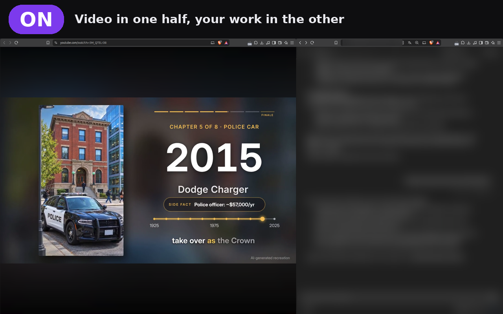
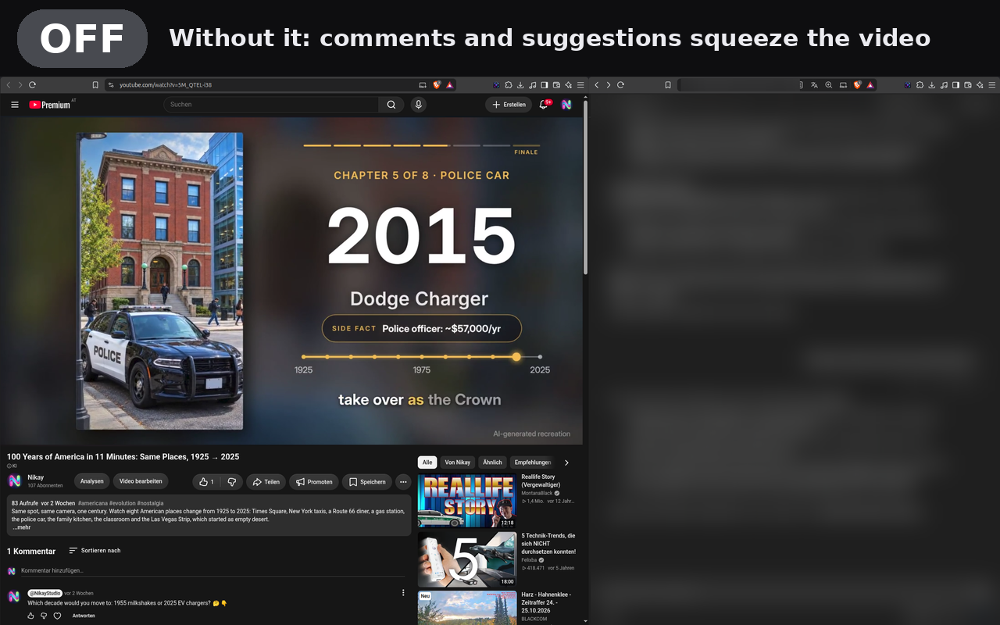

<p align="center">
  
</p>

<h1 align="center">Video Focus</h1>

<p align="center">
  <b>Watch YouTube in one half of your screen while you work in the other.</b><br>
  A browser extension for Chrome, Brave and Edge that hides everything around the video.
</p>

<p align="center">
  <a href="https://github.com/nikay99/video-focus-yt/releases/latest">Download</a> ·
  <a href="https://nikay99.github.io/video-focus-yt/">Privacy policy</a> ·
  <a href="https://github.com/nikay99/video-focus-yt/issues">Report an issue</a>
</p>

---

## What it does

Put a video window next to your editor, chat or notes. On a normal YouTube page the video gets squeezed by recommendations, comments, the title and the header. **Video Focus removes all of that**, so the video fills its half of the screen and nothing distracts you.

| ON: only the video | OFF: the normal page |
|---|---|
|  |  |

*In the screenshots the right-hand window is blurred on purpose.*

## Features

- **Only the video stays.** Recommendations, sidebar, header, title, description, comments, live chat, end cards and pause overlays are hidden. The page turns black.
- **One click.** Click the toolbar icon, or press **Alt+Shift+F**.
- **Leave with a double-click** on the video (it does not jump into fullscreen), or use the icon or the shortcut.
- **The icon shows the state.** On a YouTube video page the icon turns dark with a small grey **ON** label while focus mode is on, and is bright when it is off. On every other site the icon looks normal.
- **Only where it makes sense.** It works on regular YouTube video pages (`youtube.com/watch?v=…`). Home, search, channels, playlists and Shorts stay untouched. On other pages a click only shows a short hint.
- **English and German** interface texts, following the browser language.

## How to use it

1. Open a YouTube video in a window next to your work (for example split-screen, one half each).
2. Click the **Video Focus** icon in the toolbar. The page turns black and only the video remains.
3. Double-click the video to go back (or click the icon, or press **Alt+Shift+F**).

## Install

**From a release (manual install)**

1. Download `video-focus-vX.Y.Z.zip` from the [latest release](https://github.com/nikay99/video-focus-yt/releases/latest) and unzip it.
2. Open `chrome://extensions` (or `brave://extensions`) and turn on **Developer mode**.
3. Click **Load unpacked** and select the unzipped folder.

The Chrome Web Store version is in review. This page will link to it once it is published.

## Permissions and privacy

| Permission | Why |
|---|---|
| `storage` | Saves the on/off setting on your device. |
| `https://www.youtube.com/*` | Runs on YouTube pages to hide elements with CSS, and reads the tab address so the icon only shows the state on a video page. |

- No data is collected, stored or sent anywhere. There are no network requests, no analytics and no remote code.
- The only thing saved is one on/off value in your browser's local extension storage.
- Full text: [Privacy policy](https://nikay99.github.io/video-focus-yt/).

## Good to know

- **Only `www.youtube.com`.** The mobile site (`m.youtube.com`), YouTube Music and embedded players are not supported.
- **It depends on YouTube's page layout.** If YouTube renames its page elements, something may stay visible until the extension is updated. Please [open an issue](https://github.com/nikay99/video-focus-yt/issues) if that happens.
- **One setting for all tabs.** Focus mode is switched on or off for every YouTube tab at once. It only has an effect on a video page.
- **Double-click on the player controls does nothing.** A double-click on the control bar is ignored, so you can use the controls normally.

## FAQ

**Is this a fullscreen mode?** No. The browser window stays as it is (for example half of your screen). Only the page around the video is hidden.

**Why is the icon dark when the mode is on?** The page turns dark, and the icon follows. The small grey **ON** label and the tooltip say it in words.

**Why does a click on other websites only show a hint?** The mode only makes sense on a YouTube video page, so everywhere else the click does nothing except showing a short hint.

**Does it block ads or download videos?** No. It only hides page elements and does nothing else.

## Project layout

```
manifest.json     Manifest V3
background.js     toolbar icon, shortcut, per-tab icon state
content.js        switches the page into focus mode on video pages
content.css       what gets hidden
hint.html / .js   hint popup shown on pages without a video
icons/            bright icons (off) and icons/dim (on)
_locales/         English and German texts
```

## Releases

Pushing a tag like `v1.0.5` builds the extension ZIP and publishes a GitHub release (see `.github/workflows/release.yml`). The version in `manifest.json` must match the tag.

## License

MIT, see [LICENSE](LICENSE).

Video Focus is an independent project. It is not affiliated with, endorsed by or sponsored by YouTube or Google.
